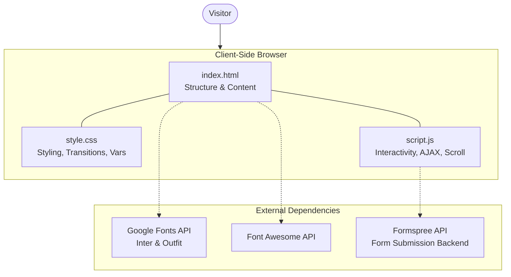
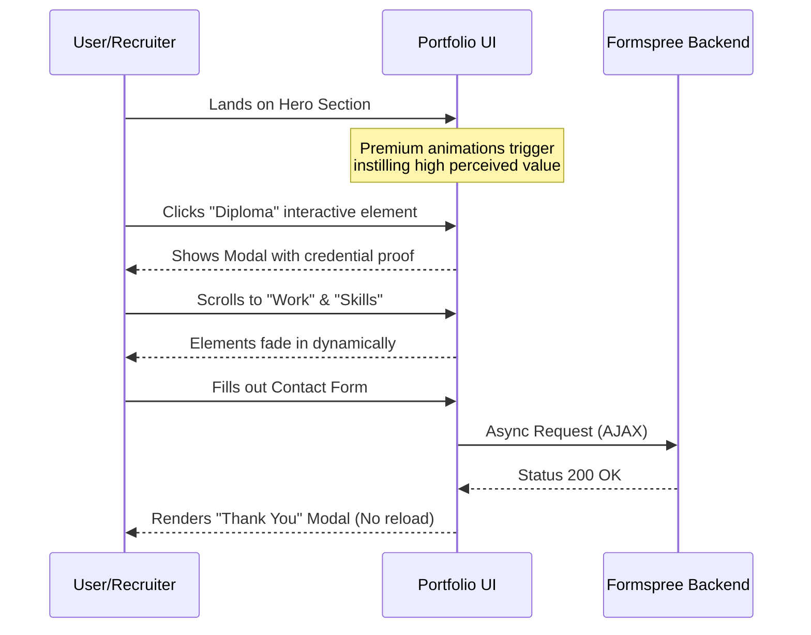

# Project Analysis: Shahen Srour Portfolio

This document provides a comprehensive analysis of the Shahen Srour Frontend Developer Portfolio repository. The exploration covers the project from three distinct perspectives: Software Architect, Software Developer, and Product Manager.

---

## 🏛️ 1. Software Architect Perspective

### System Design & Architecture
The application is a classic statically served Single-Page Application (SPA). It completely eschews complex build steps or virtual DOM libraries in favor of native web technologies (HTML, CSS, Vanilla JS), which is an excellent architectural choice for a highly animated, content-centric portfolio site.

### Component Relationship Architecture

### Scalability & Deployment
- **Performance:** Extremely lightweight. With no framework bundle to parse, the Time to Interactive (TTI) will be exceptionally low. 
- **Hosting Scalability:** Because the architecture generates no dynamic server load, it scales infinitely via any Edge/CDN hosting (Vercel, Netlify, Cloudflare Pages, GitHub Pages).
- **Architectural Bottleneck:** The primary bottleneck is content scalability. Adding new projects, skills, or experiences requires manual HTML modification rather than updating a database or Markdown file.

---

## 💻 2. Software Developer Perspective

### Code Structure & Implementation Details
- **Separation of Concerns:** The codebase maintains a strict and clean separation of HTML structure (`index.html`), behavioral logic (`script.js`), and presentation (`style.css`).
- **Styling (Vanilla CSS):**
  - **CSS Custom Properties:** Effectively uses CSS variables (`:root`) for color theming (`--bg`, `--accent`, `--support`) and typography, making future dark-mode implementations or theme changes trivial.
  - **Embedded SVGs & SVG overlays:** The hero section uses brilliant SVG inline techniques for interactive hover areas (the diploma click overlay), which requires deep CSS/SVG structural knowledge.
  - **Animations:** Relies heavily on hardware-accelerated CSS animations (`@keyframes`, `transform`, `opacity`) for smooth, performant micro-interactions.
- **JavaScript Execution:**
  - Written in modern ES6+ Vanilla JS without transpilation requirements.
  - Features a custom scroll-reveal implementation relying on `getBoundingClientRect()`. 
  - Handles the contact form submission asynchronously (`fetch`) to prevent undesirable page reloads.

### Actionable Code Refactoring Suggestions
- **Intersection Observer Refactor:** The current scroll-reveal logic attaches to the window `scroll` event and manually calculates bounds (which can cause layout thrashing). Refactoring this to use the native `IntersectionObserver` API would improve scrolling performance.
- **Form Error Handling:** Enhance user feedback on the `fetch` request failure (currently using native `alert()`) by replacing it with in-DOM toast notifications.

---

## 📈 3. Product Manager Perspective

### Features & User Workflows
The product successfully solves the primary user need: showcasing professional competency to prospective clients or employers with minimal friction. 

### Core User Flow

### Value Proposition & Usability
- **Premium Feel:** The "tripwire" navigation animations, fluid typing elements, and smooth scrolling establish immediate trust. The design aesthetic aligns closely with high-end, modern tech trends, positioning the developer as a premium asset.
- **Lead Generation:** The contact form is strategically placed at the bottom of the scroll journey and seamlessly integrates with Formspree, ensuring the owner receives leads directly to their email without managing a database.

### Roadmap & Next Steps
- **SEO & Social Sharing:** Add Open Graph (`og:image`, `og:title`) and Twitter card meta tags to the `<head>`. When recruiters share the link in Slack or LinkedIn, a rich preview image should appear.
- **Analytics Integration:** Add lightweight tracking (like Plausible or Google Analytics) to measure visitor flow. Are recruiters clicking the "Download CV" button? Are they opening the Diploma modal?
- **Content Management Migration:** If the user intends to blog or add projects frequently, migrating this exact design to a framework like Astro.js with file-based routing would drastically reduce administrative effort while maintaining the exact same stellar performance profile.
# Portfolio
